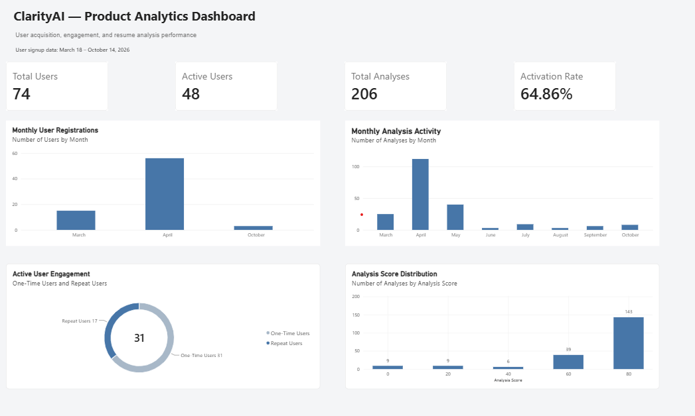
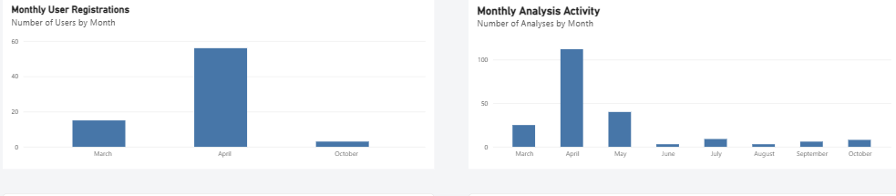
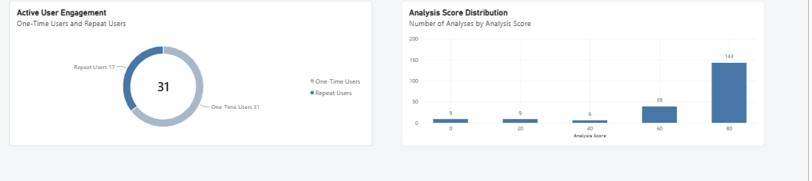

# ClarityAI — Product Analytics Dashboard

A product analytics project built with **Microsoft Power BI, DAX, SQL, and Supabase** to understand user acquisition, activation, engagement, and resume analysis activity for ClarityAI.

## Project Overview

ClarityAI is an AI-powered resume and job description analyzer designed to help job seekers evaluate how well their resumes match job opportunities.

As the product generates user activity data, understanding how users discover and engage with its features becomes important.

This project transforms application usage data into meaningful product metrics and actionable business insights.

## Business Objectives

The dashboard was designed to answer the following questions:

- How many users have registered?
- How many registered users have completed at least one analysis?
- What percentage of registered users have activated the product?
- How frequently do active users use the product?
- How many active users return for additional analyses?
- How are resume analysis scores distributed?

## Dashboard Preview

### Full Dashboard



### User Acquisition & Activity



### User Engagement & Score Distribution



## Key Metrics & Findings

| Metric                           | Result |
| -------------------------------- | -----: |
| Total Registered Users           |     74 |
| Active Users                     |     48 |
| Total Analyses                   |    206 |
| Activation Rate                  | 64.86% |
| Average Analyses per Active User |   4.29 |
| Repeat Users                     |     17 |
| One-Time Active Users            |     31 |
| Repeat User Rate                 | 35.42% |

### Key Insights

- 48 out of 74 registered users completed at least one analysis.
- 26 registered users had not completed an analysis.
- 17 active users completed more than one analysis.
- 143 out of 206 analyses fell into the highest score group.

## Business Recommendations

Based on the observed metrics, the following opportunities were identified:

1. **Improve User Activation:** Investigate why registered users do not complete their first analysis and identify opportunities to improve onboarding.
2. **Encourage Repeat Usage:** Understand the behavior of repeat users and explore ways to encourage continued product engagement.
3. **Monitor Product Engagement:** Track active users and analysis frequency over time.
4. **Evaluate Analysis Quality:** Further investigate score patterns and validate whether generated scores provide meaningful value to users.
5. **Introduce Retention Analysis:** Implement cohort-based tracking to understand whether users return over time.

## Data & Methodology

Two datasets were extracted from Supabase:

- User registration records
- Resume analysis activity records

The datasets were prepared and modeled in Power BI.

Key activities included:

- Writing SQL queries to retrieve relevant product data.
- Preparing and validating the exported datasets.
- Establishing a one-to-many relationship using `user_id`.
- Creating calculated measures using DAX.
- Building visualizations to communicate product performance.

## Tools & Technologies

- Microsoft Power BI
- Power Query
- DAX
- SQL
- Supabase / PostgreSQL

## Project Limitations

- Activation rate represents users who completed at least one analysis in the available dataset; it is not a time-bound activation metric.
- Repeat usage does not necessarily indicate user retention.
- Analysis scores do not independently establish resume quality or job application success.
- Findings describe observed data and do not establish causation.

## Project Structure

```text
clarityai-product-analytics/
│
├── README.md
├── sql/
├── data/
├── screenshots/
└── dashboard/
```

## Project Status

Dashboard development and initial product analysis completed.

Future improvements:

- Add dashboard screenshots.
- Publish a project walkthrough video.
- Explore cohort-based retention and deeper engagement analysis.
